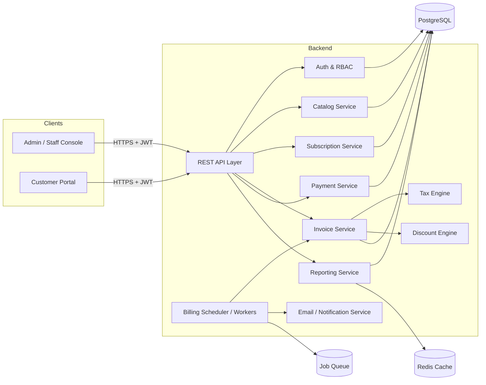
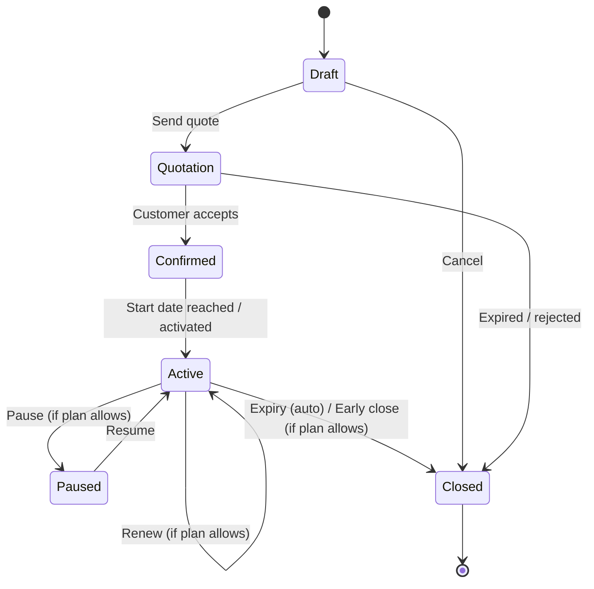
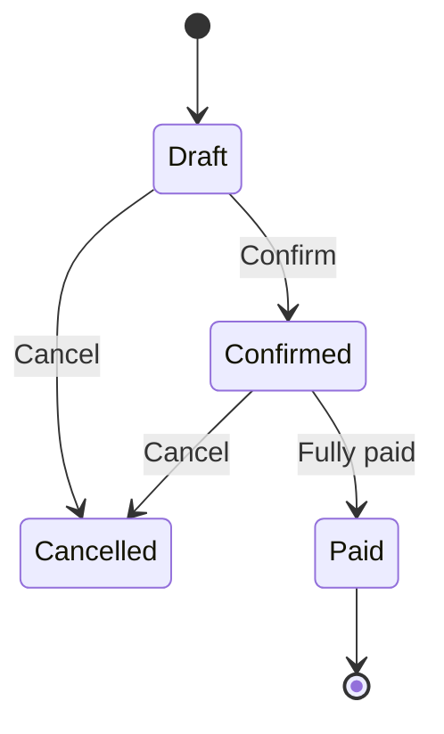

# 🔁 Brightloop Subscription Management System

> **One platform to run the entire life of a subscription business: products → plans → quotes → subscriptions → invoices → payments → revenue insights.**


---

## 📌 Table of Contents
1. [The Problem](#-the-problem)
2. [Our Solution](#-our-solution)
3. [Feature Walkthrough](#-feature-walkthrough-a-month-at-brightloop)
4. [System Architecture](#-system-architecture)
5. [Subscription & Invoice Lifecycles](#-subscription--invoice-lifecycles)
6. [Data Model](#-data-model)
7. [Role-Based Access Control](#-role-based-access-control)
8. [The Billing Engine](#-the-billing-engine-the-hard-part)
9. [Pricing, Tax & Discount Engine](#-pricing-tax--discount-engine)
10. [Performance (< 2s at scale)](#-performance--2s-at-scale)
11. [Security](#-security)
12. [Tech Stack](#-tech-stack)
13. [Getting Started](#-getting-started)
14. [API Overview](#-api-overview)
15. [Demo Script](#-demo-script-5-minutes)
16. [Testing](#-testing)
17. [Roadmap](#-roadmap)
18. [Team](#-team)

---

## 🎯 The Problem

Brightloop Software sells everything on subscription, but runs the business on spreadsheets and memory:

| Today | Consequence |
|---|---|
| Subscriptions tracked in a spreadsheet | No single source of truth |
| Renewals remembered by "whoever notices first" | **Missed renewals = lost revenue** |
| Invoices typed by hand every month | **Wrong invoices, double billing** |
| Payments matched by scrolling bank statements | Slow, error-prone reconciliation |
| Revenue reports built manually each quarter | **Nobody knows the real MRR** |

---

## 💡 Our Solution

A single, role-aware platform that **automates the full recurring-revenue loop**:

- ✅ **Zero manual invoicing**: invoices are generated from subscriptions automatically, with taxes, discounts and totals pre-filled.
- ✅ **Exactly-once billing**: an invoice can never be created twice for the same billing period, and no due subscription is skipped.
- ✅ **Rules, not memory**: taxes and discounts are admin-defined rules applied automatically.
- ✅ **Self-service portal**: customers view and manage their own subscriptions and invoices without emailing anyone.
- ✅ **Live finance dashboard**: active subscriptions, MRR, collected vs. outstanding, and overdue invoices in one place, with filters.
- ✅ **Fast at scale**: every page responds in **under 2 seconds** with thousands of subscriptions.

---

## 🗓️ Feature Walkthrough: *A Month at Brightloop*

Each module maps directly to a real scene from the problem statement.

### 1. 👤 A new customer signs up: *Auth & Accounts*
- Register with **email + password**; **one account per email** (unique constraint, case-insensitive).
- Password policy: **more than 8 characters**, with at least one **uppercase**, one **lowercase** and one **special character**. Enforced on both client and server.
- **Forgot password**: time-limited, single-use reset link sent to the registered email.
- **Three roles** (see [RBAC](#-role-based-access-control)): Admin, Internal Staff, Customer. **Only the Admin can create staff accounts.**

### 2. 🚀 Launching a new plan: *Catalog*
- **Products**: name, type, sales price, cost price, notes.
- **Variants**: e.g. by brand, where choosing *Odoo* adds **+560** to the price (attribute → value → price extra).
- **Plans**: price, **billing period** (daily / weekly / monthly / yearly), minimum quantity, availability window.
- **Per-plan lifecycle flags** (admin chooses per plan): auto-close at end date, closable early, pausable, renewable.

### 3. 📝 Turning a quote into a subscription: *Quotes & Subscriptions*
- **Quotation templates**: prefilled plan + product lines, with a validity period (days).
- Each subscription has a **unique number**, customer, plan, start date, expiry date, payment terms and **line items** (product, qty, unit price, taxes, amount).
- Visible **status pipeline**: `Draft → Quotation → Confirmed → Active → Closed`.

### 4. 🧾 Billing day: *Automated Invoicing*
- A scheduled job generates invoices for **every due subscription**: no typing.
- Customer details, lines, taxes, discounts and totals auto-filled.
- Staff can **confirm, cancel, send and print (PDF)** any invoice.
- Invoice status: `Draft → Confirmed → Paid`.
- **Nothing billed twice, nothing skipped** (see [Billing Engine](#-the-billing-engine-the-hard-part)).

### 5. 🏷️ A customer asks for a better price: *Discounts*
- **Admin-only** discount rules: fixed amount or percentage.
- Conditions: minimum purchase value / minimum quantity, start & end dates, **usage limit**.
- Scope: **specific products** or **whole subscriptions**.
- Applied **automatically** on the next invoice; stops on expiry or when the usage limit is reached.

### 6. 💰 The money comes in: *Payments*
- Record payments with **method, amount, date and note** against the correct invoice.
- Supports **partial and multiple payments** per invoice; the invoice flips to *Paid* when fully settled.
- Live **Paid vs Outstanding** view; overdue invoices are flagged for follow-up.

### 7. 📊 Month-end review: *Finance Dashboard*
- One screen for: **active subscriptions, revenue collected, amount owed, overdue invoices**.
- Filters (date range, customer, plan, status) and a summary view.
- Export to CSV.

---

## 🏗️ System Architecture



**Design principles**
- **Modular monolith**: clear module boundaries, simple to deploy and demo, easy to split later.
- **Database as the source of truth for invariants**: uniqueness and integrity are enforced by constraints, not just application code.
- **Background workers** for billing and email so the UI never blocks.

---

## 🔄 Subscription & Invoice Lifecycles

### Subscription


### Invoice

> Transitions are enforced by a **server-side state machine**; illegal transitions are rejected with a clear error.

---

## 🗄️ Data Model

```mermaid
erDiagram
    USER ||--o{ SUBSCRIPTION : owns
    PRODUCT ||--o{ VARIANT : has
    PRODUCT ||--o{ SUBSCRIPTION_LINE : "sold as"
    PLAN ||--o{ SUBSCRIPTION : governs
    QUOTE_TEMPLATE ||--o{ QUOTE_TEMPLATE_LINE : contains
    SUBSCRIPTION ||--|{ SUBSCRIPTION_LINE : has
    SUBSCRIPTION ||--o{ INVOICE : generates
    INVOICE ||--|{ INVOICE_LINE : has
    INVOICE ||--o{ PAYMENT : "settled by"
    TAX_RULE ||--o{ SUBSCRIPTION_LINE : applies_to
    DISCOUNT_RULE ||--o{ DISCOUNT_USAGE : tracked_by
    INVOICE ||--o{ DISCOUNT_USAGE : consumes

    USER { uuid id PK; string email UK; string password_hash; enum role }
    PRODUCT { uuid id PK; string name; string type; decimal sales_price; decimal cost_price; text notes }
    VARIANT { uuid id PK; uuid product_id FK; string attribute; string value; decimal extra_price }
    PLAN { uuid id PK; decimal price; enum period; int min_qty; date available_from; date available_to; bool auto_close; bool closable; bool pausable; bool renewable }
    SUBSCRIPTION { uuid id PK; string number UK; uuid customer_id FK; uuid plan_id FK; date start_date; date expiry_date; string payment_terms; enum status; date next_billing_date }
    INVOICE { uuid id PK; string number UK; uuid subscription_id FK; date period_start; date period_end; decimal subtotal; decimal tax_total; decimal discount_total; decimal total; enum status; date due_date }
    PAYMENT { uuid id PK; uuid invoice_id FK; string method; decimal amount; date paid_on; text note }
    TAX_RULE { uuid id PK; string name; decimal rate; bool active }
    DISCOUNT_RULE { uuid id PK; enum type; decimal value; decimal min_amount; int min_qty; date starts_on; date ends_on; int usage_limit; int used_count; enum scope }
```

**Key constraints**
- `USER.email` is **unique (case-insensitive)**.
- `INVOICE (subscription_id, period_start, period_end)` is **unique**, which is the database-level guarantee against double billing.
- Money is stored as **fixed-precision decimals** (never floats).

---

## 🔐 Role-Based Access Control

| Capability | Admin | Internal Staff | Customer |
|---|:---:|:---:|:---:|
| Create / manage staff accounts | ✅ | ❌ | ❌ |
| Manage products, variants, plans | ✅ | 👁️ view | 👁️ browse |
| Manage taxes | ✅ | ❌ | ❌ |
| Create discount rules | ✅ | ❌ | ❌ |
| Create quotes / subscriptions | ✅ | ✅ | ❌ |
| Confirm / cancel / send / print invoices | ✅ | ✅ | ❌ |
| Record payments | ✅ | ✅ | ❌ |
| View finance dashboard | ✅ | ✅ (limited) | ❌ |
| View **own** subscriptions & invoices | ✅ | ✅ | ✅ |
| Manage **own** subscription (pause/renew/close, if plan allows) | ✅ | ✅ | ✅ |

Enforced **server-side on every route** (middleware + ownership checks). Customers can never access another customer's data, even by guessing IDs.

---

## ⚙️ The Billing Engine (the hard part)

Billing day means **hundreds of subscriptions due at once**. Our engine is built around three guarantees:

1. **Exactly-once**: a unique constraint on `(subscription_id, period_start, period_end)` plus an idempotent job. Re-running the job, a crash mid-run or two workers racing can never produce duplicates.
2. **No skips**: the scheduler selects *all* `Active` subscriptions where `next_billing_date <= today`, so missed runs are **caught up** on the next run.
3. **Fault isolation**: each subscription is billed in its **own transaction**; one failure never blocks the batch and failures are logged and retried.

```
Scheduler (daily)
  └─ find due subscriptions  (Active AND next_billing_date <= today)
       └─ for each (in its own transaction, with row lock):
            1. build lines from subscription
            2. apply tax rules
            3. apply eligible discounts (increment usage atomically)
            4. insert invoice (unique period key → idempotent)
            5. advance next_billing_date by plan period
            6. enqueue email notification
```

Also handled: auto-close on expiry, auto-expire stale quotes, and overdue marking.

---

## 🧮 Pricing, Tax & Discount Engine

**Line amount** = `(base price + variant extra) × qty`

```
subtotal   = Σ line amounts
discount   = best eligible rule(s)        (fixed / % ; scoped to product or subscription)
taxable    = subtotal − discount
tax        = taxable × tax rate(s)        (admin-defined rules)
total      = taxable + tax
```

- **Variant pricing**: e.g. *Brand = Odoo* → `+560`.
- **Discount eligibility** checks: active date window, minimum purchase/quantity met, usage limit not exhausted, scope matches.
- **Usage limit** is incremented atomically to avoid over-redemption under concurrency.
- Discounts appear on the **next invoice automatically** and **stop on their own** at expiry or limit.

---

## ⚡ Performance (< 2s at scale)

Target: **every page responds in < 2 seconds with thousands of subscriptions.**

| Technique | Where |
|---|---|
| Indexes on `status`, `next_billing_date`, `customer_id`, `due_date`, `email` | Core tables |
| **Server-side pagination**, filtering and sorting | All list views |
| Aggregate queries (`GROUP BY`) in SQL, not in application code | Dashboard |
| **Redis caching** of dashboard KPIs (short TTL, invalidated on write) | Reporting |
| N+1 avoidance via joins / eager loading | List endpoints |
| Billing, email and PDF generation in **background workers** | Billing day |

> 📈 Load test results: _add your measured numbers here (e.g. p95 latency at 10k subscriptions)._

---

## 🛡️ Security

- Passwords hashed with **bcrypt/argon2**; never stored or logged in plain text.
- **JWT** access tokens with expiry; role claims verified on the server.
- Password reset tokens are **hashed, single-use and time-limited**.
- Input validation on every endpoint; **parameterised queries** (no SQL injection).
- Rate limiting on login and reset endpoints.
- **Object-level authorisation**: customers can only read their own records.
- Audit trail for money-affecting actions (invoice state changes, payments, discount edits).

---

## 🧰 Tech Stack

> _Edit this section to match what you actually built._

| Layer | Choice |
|---|---|
| Frontend | React / Next.js, TypeScript, Tailwind CSS |
| Backend | Node.js (NestJS / Express), TypeScript |
| Database | PostgreSQL |
| Cache & Queue | Redis, BullMQ |
| Auth | JWT + refresh tokens, bcrypt |
| Email | SMTP / Nodemailer |
| PDF | Puppeteer / PDFKit |
| DevOps | Docker, Docker Compose, GitHub Actions |

---

## 🚀 Getting Started

### Prerequisites
- Node.js 20+
- PostgreSQL 15+ and Redis 7+ (or just Docker)

### Quick start with Docker
```bash
git clone <your-repo-url>
cd brightloop-subscriptions
cp .env.example .env
docker compose up --build
```

### Manual setup
```bash
npm install
cp .env.example .env        # fill in DB, Redis, JWT and SMTP values
npm run db:migrate
npm run db:seed             # demo data: admin, staff, customers, plans, subscriptions
npm run dev
```

### Environment variables
| Variable | Description |
|---|---|
| `DATABASE_URL` | PostgreSQL connection string |
| `REDIS_URL` | Redis connection string |
| `JWT_SECRET` | Secret for signing tokens |
| `SMTP_HOST` / `SMTP_USER` / `SMTP_PASS` | Email for reset links and invoices |
| `APP_URL` | Base URL used in email links |

### Demo credentials (seeded)
| Role | Email | Password |
|---|---|---|
| Admin | `admin@brightloop.test` | `Admin@1234` |
| Staff | `staff@brightloop.test` | `Staff@1234` |
| Customer | `customer@brightloop.test` | `Customer@1234` |

---

## 🔌 API Overview

| Area | Endpoints |
|---|---|
| Auth | `POST /auth/register` · `POST /auth/login` · `POST /auth/forgot-password` · `POST /auth/reset-password` |
| Staff (admin) | `POST /staff` · `GET /staff` |
| Catalog | `CRUD /products` · `CRUD /products/:id/variants` · `CRUD /plans` |
| Quotes | `CRUD /quote-templates` · `POST /subscriptions/from-template/:id` |
| Subscriptions | `GET/POST /subscriptions` · `PATCH /subscriptions/:id/status` · `POST /subscriptions/:id/{pause,renew,close}` |
| Invoices | `GET /invoices` · `POST /invoices/:id/{confirm,cancel,send}` · `GET /invoices/:id/pdf` |
| Billing | `POST /billing/run` (admin, manual trigger) |
| Payments | `POST /invoices/:id/payments` · `GET /payments` |
| Discounts & Taxes | `CRUD /discounts` · `CRUD /taxes` (admin) |
| Reports | `GET /reports/summary` · `GET /reports/overdue` · `GET /reports/revenue` |

_Full OpenAPI/Swagger docs available at `/api/docs` when the server is running._

---

## 🎬 Demo Script (5 minutes)

1. **Sign up** as a customer: try a weak password, see validation, then succeed. Trigger **forgot password**.
2. **Admin**: create a product with an *Odoo* brand variant (+560), then a monthly plan.
3. **Admin**: create a **15% discount** (min. quantity 5, usage limit 3) and a tax rule.
4. **Staff**: build a quote from a **template**, confirm it and watch the status move to **Active**.
5. **Billing day**: click *Run billing*. See invoices generated for all due subscriptions, with tax and discount applied.
6. **Run billing again**: show that **zero duplicates** are created.
7. **Staff**: confirm and send an invoice, download the PDF, then record a **partial payment** followed by the remainder. It flips to **Paid**.
8. **Customer portal**: shows only their own subscriptions and invoices.
9. **Finance dashboard**: active subscriptions, revenue, outstanding, overdue, with filters, loading in under 2s on a seeded 10k-subscription dataset.

---

## 🧪 Testing

```bash
npm run test          # unit tests
npm run test:e2e      # end-to-end API tests
npm run test:load     # load test (k6)
```

Focus areas: password validation rules, role permissions, state-machine transitions, **idempotent billing**, discount usage limits under concurrency, tax and total calculations.

---

## 🗺️ Roadmap

- [ ] Payment gateway integration (Stripe / Razorpay) with webhooks
- [ ] Dunning: automated reminders for overdue invoices
- [ ] Proration on mid-cycle upgrades and downgrades
- [ ] MRR / churn / LTV analytics and cohort charts
- [ ] Multi-currency and multi-tax-region support
- [ ] Usage-based billing and metered add-ons
- [ ] Webhooks and public API keys for integrations

---

## 👥 Team

| Name | Role | Contact |
|---|---|---|
| **Dipak Pal** | Team Lead / Architecture | [officialdipakpal-lab](https://github.com/officialdipakpal-lab) |
| **Shivam Yadav** | Full Stack / Integrations | [Shivam-Yadav7524](https://github.com/Shivam-Yadav7524) |
| **Vijay Sharma** | Frontend & UI Portal Lead | vijay.sharma@brightloop.test |
| **Anirudh Kumar** | Backend & Database Systems | anirudh.kumar@brightloop.test |

---

<p align="center"><b>Brightloop: because recurring revenue should run itself.</b></p>
